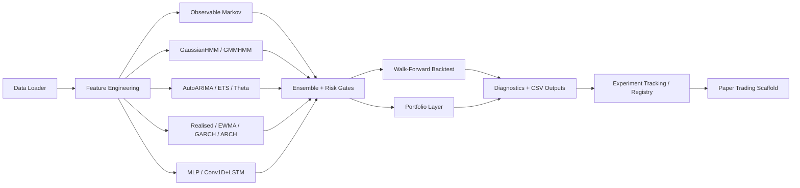
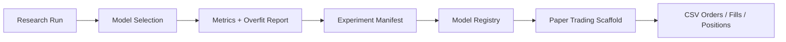

# Architecture

The pipeline is:

`data -> features -> HMM -> optional NN -> ensemble -> position sizing -> backtest -> diagnostics -> stress -> reporting`

`data.py` loads asset OHLCV, benchmark close, and optional factor closes. `features.py`
creates base technical/regime features plus optional cross-asset factors. `hmm_model.py`
and `model_selection.py` fit Gaussian HMM regimes and map raw components into Bull,
Bear, and Sideways semantic probabilities.

`backtest.py` turns regime probabilities into positions with volatility targeting,
drawdown throttles, costs, and optional ensemble confirmation. `runner.py` writes the
standard reports and delegates to nested optimisation, portfolio, model comparison,
experiment tracking, and paper simulation modes.

